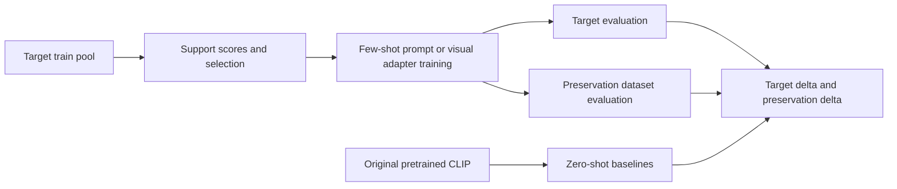

# CLIP Adaptation and Zero-Shot Preservation — Research Archive

**Status: closed exploratory research.** This archive preserves attempts, observations and incomplete evidence. It does not present a finalized method, a publication or a new state of the art. Closure was specified by the researcher; the available records do not establish why the project ended.

## Project overview and motivation

A pretrained CLIP model classifies images by comparing image features with text features for class names. Few-shot adaptation changes the prompt or a visual adapter to fit a target dataset. The same learned component can also change predictions on other datasets. The research asks how support selection and knowledge-preservation constraints affect that adaptation/generalization trade-off.

The main question is: **which target support samples improve adaptation while reducing degradation of the original model's zero-shot performance?** Secondary questions concern confidence versus uncertainty, text representation drift, teacher agreement, and reference distillation. These are research questions, not claims that every adaptation degrades every dataset.

## Problem definition and methodology

The verified CoOp path freezes CLIP encoders and trains shared prompt context. The visual CLIP-Adapter path trains a separate visual adapter. CoCoOp has its own implementation and must not be silently pooled with CoOp. Actual selection code includes random, teacher confidence, teacher margin, prototype similarity, negative-confidence uncertainty, entropy, text drift, two-teacher agreement and JS-quantile diagnostics. Negative confidence and entropy are different criteria.

The two-teacher extension uses original CLIP plus an adapted teacher; the LoRA teacher uses the full target train pool before selecting few-shot student supports. It is therefore not an equal-resource pure few-shot teacher. Reference-distillation and GIFT-inspired packages are experimental adaptations of ideas from prior work, not official ZSCL/GIFT reproductions. Some methods have only code and scripts, or graph-derived summaries without recoverable nonempty run metadata.



This diagram describes the inspected base workflow; optional teachers and distillation have separate source paths. The generalization evaluation uses ImageNet/CIFAR-100 and must not be described as validation of arbitrary unseen tasks.

## Research and experiment workflow

The source-supported progression is base CoOp/adapter trade-off study → support selection variants → text drift and reference-preservation extensions → two-teacher/LoRA/WC and JS diagnostics. This is a dependency-based reconstruction. The files do not establish an exact dated order among every parallel experiment. [Research history](docs/HISTORY.md) separates recoverable evidence from hypotheses.

## Repository structure

```text
CLIP/
  코드/                 source variants and surviving records
  실험완료/             historical experiment packages (name is not completion evidence)
  그래프/               standalone plotted tables and figures
docs/                   overview, results, history, reproduction and provenance
results/                derived indexes with explicit source and evidence tier
provenance/             hashes, duplicates, empty-file audit and exclusions
tools/                  table restoration, index regeneration and validation
environments/           observed environment metadata
```

Each package retains its `src/`, trainers, scripts, original requirements and result layout. Shared source versions were compared by hash rather than merged: similarly named modules changed across studies, and preserving imports takes priority over deduplication.

## Experimental setup

Recoverable base runs use OpenCLIP `ViT-B-32-quickgelu`, pretrained `openai`, DTD/texture target, shots 1/2/4/8/16, split seed 42 and prompt initialization seed 777. Representative CoOp runs use 50 epochs, LR .002, batch 128 and 16 context tokens; visual adapter runs use a different LR. Exact settings live in each nonempty `args.json`/`results.json` and script. DTD base evaluation has 2,820 target images, 5,000 ImageNet images and 10,000 CIFAR-100 images in the inspected records. These local splits/subsets should not be assumed identical to official benchmarks.

The base original zero-shot accuracies are DTD **42.482%**, ImageNet **60.500%**, CIFAR-100 **64.930%**, from nonempty base `zero_shot_baselines.json`. Initialized CoOp epoch 0 is not necessarily original zero-shot; some later writers explicitly inject the zero-shot record at epoch 0. The recorded baseline file and writer semantics determine the comparison.

## Results

[Results and evidence boundaries](docs/RESULTS.md) reports recoverable final records and graph-only evidence separately. [Graph summary CSV](results/graph_epoch50_shot16.csv) includes source paths, epoch, shot and recorded support-seed counts; it is not an automatically matched benchmark leaderboard. [Raw final-run index](results/raw_final_results.csv) is regenerated from nonempty `results.json`, excludes smoke and retains duplicate origin flags.

For example, the base random CoOp support-seed study improves target accuracy while decreasing preservation accuracy in the recorded mean; text-drift and teacher selection should be judged by both axes. Negative/no-improvement results and empty evidence are kept. A repeated copy of a result does not add another seed. Support-selection seeds are not independent model-initialization replicates.

## Limitations and research status

Single-target emphasis, differing resource budgets and incomplete archived records limit comparison. Several wrapper/entropy/distillation run files are zero bytes; standalone graph CSVs survive for some of them. Such plots demonstrate recorded summaries, but do not establish missing settings or reproducibility. Selection of teachers using recorded target performance and post-hoc best-case plots can introduce selection bias. Full-data LoRA teachers and reference datasets are extra resources. No universal preservation guarantee or explanation of project closure is established.

No additional development is scheduled for this closed archive. Unverified questions include transfer across targets, independent model seeds and whether observed text drift causally predicts generalization. [Reproduction](docs/REPRODUCIBILITY.md) states exactly what was checked during packaging.

## Start here

- [Experiment catalogue](docs/EXPERIMENTS.md)
- [Results](docs/RESULTS.md) / [history](docs/HISTORY.md)
- [Reproduction](docs/REPRODUCIBILITY.md) / [provenance](docs/PROVENANCE.md)
- [한국어 안내](docs/GUIDE_KO.md) / [private upload commands](docs/UPLOAD.md)

[Live experiment record index](docs/EXPERIMENT_INDEX.md) includes future registered experiments.

## Browse by category

[Categorized directory and file map](docs/CATEGORIES.md) describes every top-level item and each CLIP code, experiment-package and graph collection. Each folder guide links its purpose, evidence state and original sources.
